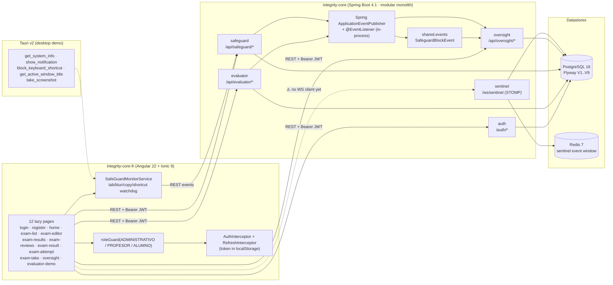
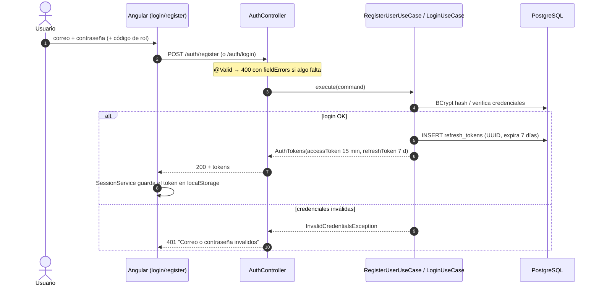
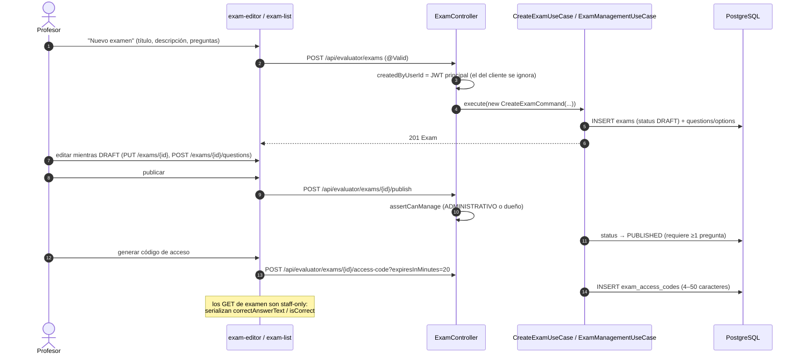
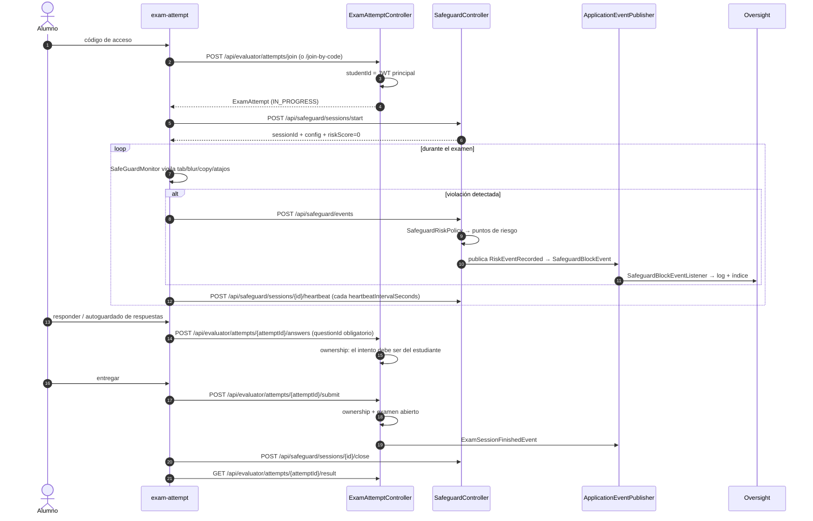
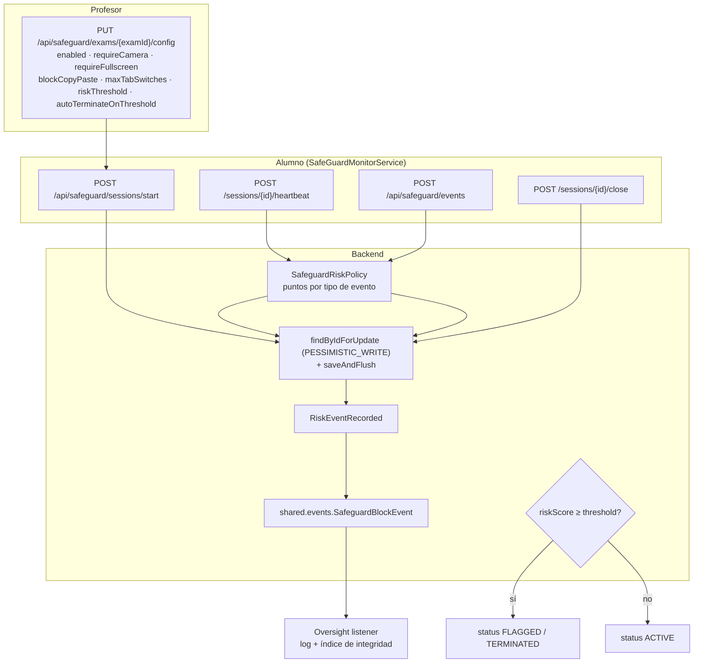
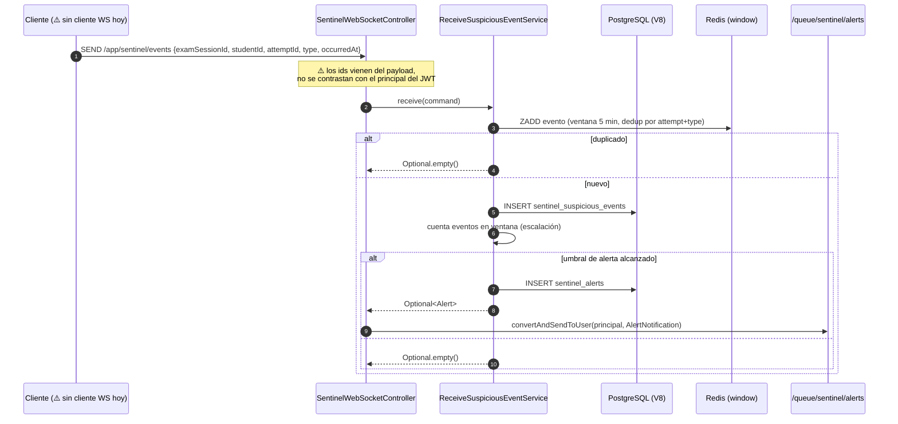
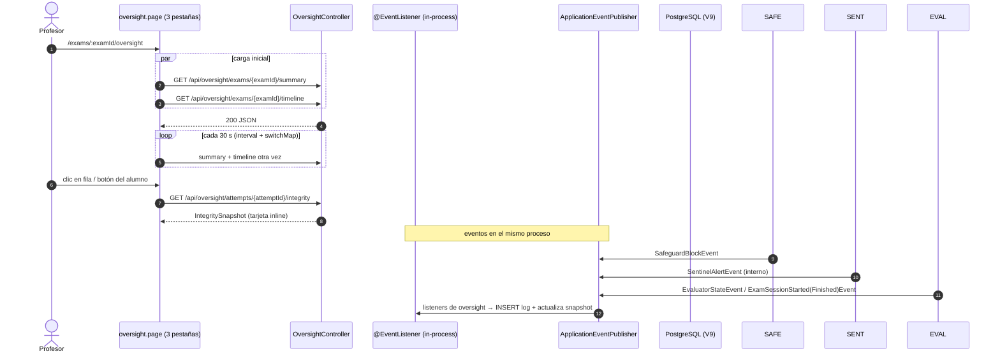
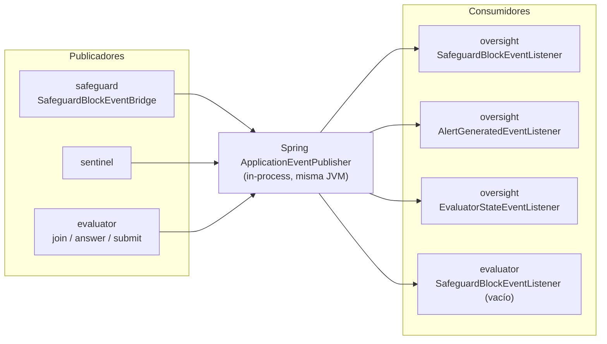
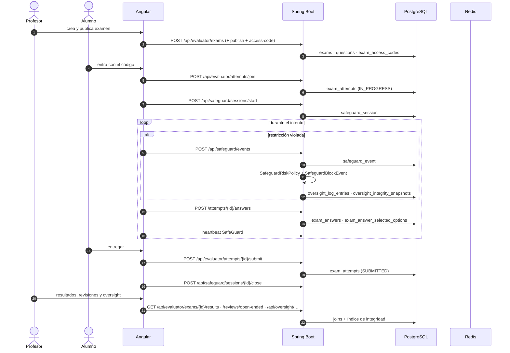
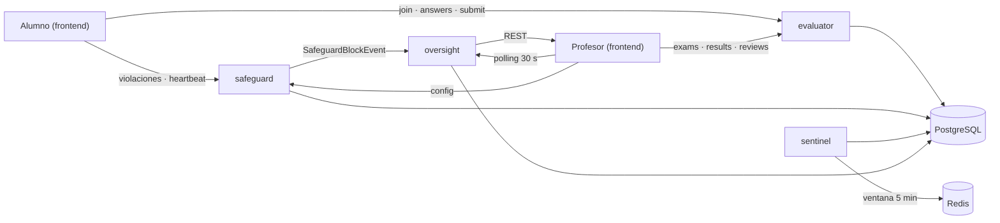

# CIDEM Integrity - Project Flow Documentation

## Overview

This document describes the complete flow of the CIDEM Academic Integrity Platform, covering the backend (Spring Boot 4.1, Java 25) and frontend (Angular 22 + Ionic 9) with Tauri v2 for desktop demo capabilities.

> Every endpoint, class and table named below was verified against the source tree on 2026-10-09.
> Items that are designed but **not implemented yet** are marked `⚠️ not implemented` and are
> tracked in `ToDo.md` § *Pendientes de auditoría*.

## Architecture

### Backend Modules (Hexagonal/Ports-Adapters)

```
integrity-core/
├── auth/                 # Authentication & Authorization (JWT, roles, registration)
│   ├── application/  domain/  infrastructure/
├── evaluator/            # Exam management, attempts, answers, reviews
│   ├── application/  domain/  infrastructure/
├── sentinel/             # Suspicious events + alerts, STOMP /ws/sentinel
│   ├── ports/  adapters(in|out)/  application/  domain/
├── safeguard/            # Exam restrictions config, monitored sessions, block events
│   ├── application/  domain/  infrastructure/
├── oversight/            # Teacher dashboard data (summary, timeline, integrity index)
│   ├── ports/  adapters(in|out)/  application/  domain/
├── shared_kernel/        # Shared exceptions, utilities (placeholder, README only)
├── shared/events/        # Cross-module event contracts (SafeguardBlockEvent today)
└── config/               # Redis, CORS, security configuration
```

Module state (do not assume parity):

| Module | Persistence | Web surface |
|--------|-------------|-------------|
| `auth` | Postgres (`V1`,`V2`,`V5`) | `/auth/*` REST |
| `evaluator` | Postgres (`V3`,`V4`,`V6`) | `/api/evaluator/*` REST |
| `safeguard` | Postgres (`V7`) | `/api/safeguard/*` REST |
| `sentinel` | Postgres (`V8`) + Redis window | STOMP `/ws/sentinel` only (no REST) |
| `oversight` | Postgres (`V9`) | `/api/oversight/*` REST (polling) |

### System context



### Container / ports

| Process | Port | Notes |
|---------|------|-------|
| backend | 8080 | Flyway migrates on startup, `ddl-auto: validate` |
| frontend | 8081 | Dockerfile + `www/` output (Vercel/`vercel.json` rewrites `environment.prod.ts` from `API_URL`) |
| Postgres | 5432 | external compose volume `b98896fb802f…` must be created first |
| Redis | 6379 | sentinel rolling window |

---

## Core Flows

### 1. Authentication Flow

Actual controllers: `AuthController` (`@RequestMapping("/auth")`) — **no `/api` prefix**.

| Method | Path | Notes |
|--------|------|-------|
| GET | `/auth/countries` | public, seeded by `V5` |
| POST | `/auth/register` | public, needs role registration code |
| POST | `/auth/admin/register` | `@PreAuthorize` ADMINISTRATIVO |
| POST | `/auth/admin/registration-codes` | ADMINISTRATIVO |
| POST | `/auth/login` | → access + refresh token |
| POST | `/auth/refresh` | rotates the refresh token (rate limited) |
| POST | `/auth/logout`, `/auth/logout-all` | revokes refresh tokens |
| GET | `/auth/users` | ADMINISTRATIVO |



**Roles**: `ADMINISTRATIVO`, `PROFESOR`, `ALUMNO` (`roleGuard(...)` in `app.routes.ts`, plus `@PreAuthorize` on staff endpoints).

---

### 2. Exam Creation Flow (Professor)



Main endpoints: `GET/POST /api/evaluator/exams`, `GET/PUT/DELETE /api/evaluator/exams/{examId}`,
`publish`, `close`, `questions`, `question-banks/{bankId}/import`, `access-code`,
`results`, `results/page`, `results/export` (CSV), `average`, and
`/api/evaluator/question-banks` CRUD.

---

### 3. Student Exam Taking Flow



**SafeGuard Protection** (active during exam): tab switch (`visibilitychange`), window blur,
copy/paste/cut, context menu, restricted shortcuts (F12, Ctrl+Shift+I…). Every violation is a
`POST /api/safeguard/events` call; risk points are computed by `SafeguardRiskPolicy` and the
session moves `ACTIVE → FLAGGED → TERMINATED` once `riskThreshold` / `autoTerminateOnThreshold`
apply.

---

### 4. SafeGuard Monitoring Flow



Rules (approved 2026-10-01): config write requires `@PreAuthorize("hasAnyRole('ADMINISTRATIVO','PROFESOR')")`;
students may **read** config only for exams where they have an attempt.

---

### 5. Sentinel Event Processing Flow

Sentinel has **no REST controller**: the only ingress is the STOMP endpoint `/ws/sentinel`
(JWT interceptor builds `SentinelPrincipal`), destination `/app/sentinel/events`.



Ports: `SuspiciousEventRepositoryPort` → `JpaSuspiciousEventRepositoryAdapter`,
`AlertRepositoryPort` → `JpaAlertRepositoryAdapter`, `EventWindowPort` → `RedisEventWindowAdapter`.

---

### 6. Oversight Monitoring Flow (Teacher Dashboard)

Oversight today is **REST + polling**; the real-time layer is designed but not implemented.



**Integrity index** (`IntegrityScoringPolicy`): base 100, penalizaciones por evento; snapshot
guardado con lectura bloqueante (`findByAttemptIdForUpdate`, `PESSIMISTIC_WRITE`) para evitar
lost updates entre el polling y los listeners.
Risk levels: `GREEN ≥ 80`, `YELLOW 50–79`, `RED < 50`.

> ⚠️ **Not implemented**: `/ws/oversight` STOMP endpoint and `OversightWebSocketService`
> (described in the old plan) do not exist — neither does any WebSocket client in
> `integrity-core-fr` (no `@stomp/stompjs` dependency). Today the UI is fed by polling only.

---

### 7. Redis Usage (Evaluator autosave ⚠️ not implemented)

What Redis actually does today:

- **Sentinel event window** (`RedisEventWindowAdapter`, sorted set, 5 min TTL) for deduplication
  and escalation counting.

What the original Sprint 6 design described but is **not in the codebase**:

- `evaluator:session:{attemptId}` autosave endpoints
  (`PUT /api/evaluator/sessions/{attemptId}/answers|time|question|activity|submit`) and
  `GET /api/evaluator/sessions/{attemptId}` recovery — no `ExamSession` class, controller or
  Redis adapter exists under `evaluator/`. Tracked in `ToDo.md`.

---

### 8. Event Contracts (Shared Events)

All events share standard fields:

```json
{
  "eventId": "uuid",
  "examId": "uuid",
  "attemptId": "uuid",
  "examSessionId": "uuid",
  "studentId": "uuid",
  "occurredAt": "ISO8601",
  "source": "MODULE_NAME",
  "payload": { }
}
```

| Event | Published by | Consumed by | Contract |
|-------|--------------|-------------|----------|
| `SafeguardBlockEvent` | `safeguard` bridge | `oversight` listener (registered), `evaluator` listener (empty, Sprint 7) | **`shared.events`** ✅ |
| `RiskEventRecorded` | `safeguard` (internal) | safeguard bridge → `SafeguardBlockEvent` | internal |
| `SentinelAlertEvent` | `sentinel` (intended) | `oversight` listener | ⚠️ naming not unified |
| `EvaluatorStateEvent` | `evaluator` (answer submit) | `oversight` listener | internal |
| `ExamSessionStartedEvent` / `ExamSessionFinishedEvent` | `evaluator` (join / submit) | `oversight` listener | internal |



⚠️ Design debt: listeners run **inside** the publisher's transaction (should be
`@TransactionalEventListener(AFTER_COMMIT)`), and only `SafeguardBlockEvent` uses the shared
contract package. See `ToDo.md` § *Pendientes de auditoría*.

---

### 9. Tauri Desktop Demo Capabilities

**Native Commands (SafeGuard integration):**
- `get_system_info()` — OS, arch, hostname
- `show_notification(title, body)` — desktop notifications
- `block_keyboard_shortcut(shortcut)` — OS-level shortcut blocking
- `get_active_window_title()` — active window monitoring
- `take_screenshot()` — screen capture for proctoring

**Security CSP:**

```
default-src 'self' ipc: http://localhost:8080 ws://localhost:8080
script-src 'self' 'unsafe-inline' 'unsafe-eval'
connect-src 'self' http://localhost:8080 ws://localhost:8080
```

---

## End-to-end sequence (examen completo)



---

## Data Model

```mermaid
erDiagram
    countries ||--o{ users : belongs
    users ||--o{ phone_numbers : has
    users ||--o{ refresh_tokens : has
    users ||--o{ registration_codes : issues
    users ||--o{ exams : creates
    exams ||--o{ questions : has
    questions ||--o{ question_options : has
    exams ||--o{ exam_access_codes : issues
    exams ||--o{ exam_attempts : receives
    users ||--o{ exam_attempts : attempts
    exam_attempts ||--o{ exam_answers : answers
    exam_answers }o--|| questions : about
    exam_answers ||--o{ exam_answer_selected_options : marks
    exam_answers ||--o| evaluation_reviews : reviewed_by
    users ||--o{ question_banks : creates
    question_banks ||--o{ questions : stores

    exams ||--o| safeguard_configuration : configured
    exam_attempts ||--o{ safeguard_session : monitored_by
    safeguard_session ||--o{ safeguard_event : records
    exam_attempts ||--o{ sentinel_suspicious_events : raises
    sentinel_suspicious_events ||--o{ sentinel_alerts : escalates_to
    exam_attempts ||--o{ oversight_log_entries : logs
    exam_attempts ||--o|| oversight_integrity_snapshots : scores
```

Migrations: `V1` auth core · `V2` registration codes · `V3` evaluator schema ·
`V4` question bank owner · `V5` seed México · `V6` review timestamps ·
`V7` safeguard tables · `V8` sentinel tables · `V9` oversight tables.
Never edit an applied `V*`; add the next version.

---

## Data Flow Summary



---

## Deployment

### Docker Compose (Local/Production)

```yaml
services:
  db:       PostgreSQL 16   # volumen externo: crearlo antes con `docker volume create …`
  redis:    Redis 7
  backend:  Spring Boot (8080)
  frontend: Angular/Ionic (8081)
```

### Environment Variables (Backend)

- `JWT_SECRET` (≥32 chars) — no default, the app fails to start without it
- `ADMIN_REGISTRATION_CODE`, `PROFESOR_REGISTRATION_CODE`
- `SPRING_DATASOURCE_URL/USERNAME/PASSWORD` (outside Compose)
- `CORS_ALLOWED_ORIGINS` (default `http://localhost:8081,http://localhost:4200`)
- `security.rate-limit.trust-proxy-header` (default `false`: `X-Forwarded-For` ignored)

### CI/CD Pipeline (`.github/workflows/ci.yml`, push/PR → `main`)

1. Backend: `./mvnw -B --no-transfer-progress verify` → `docker build`
2. Frontend: `npm ci` → `npm run lint` → production build → `docker build` (order matters)
3. Deploy: Oracle Cloud / VPS with Nginx reverse proxy
4. Healthcheck: `/actuator/health`

---

## Key Technologies

| Layer | Technology |
|-------|------------|
| Backend | Spring Boot 4.1, Java 25, Maven |
| Database | PostgreSQL 16 (Flyway migrations, `ddl-auto: validate`) |
| Cache/Windows | Redis 7 (sentinel event window) |
| Auth | JWT (access 15 min, refresh 7 d) |
| Real-time | STOMP over WebSocket (`/ws/sentinel`) |
| Frontend | Angular 22 (zoneless), Ionic 9, Bootstrap 5, TypeScript |
| Desktop | Tauri v2, Rust |
| Testing | JUnit 5, Testcontainers, Vitest |
| Build | Maven, npm, Docker |

---

## Testing Strategy

- **Unit tests**: domain logic, policies, mappers (no containers)
- **Integration tests**: `@SpringBootTest` + Testcontainers (PostgreSQL 16 + Redis) — needs a
  container runtime (Docker/Podman); tests do not need the app env vars
- **Web layer**: `@WebMvcTest` + `@Import(SecurityConfig.class)` for authorization slices
  (`AuthControllerTest`, `SafeguardConfigAuthorizationTest`, `AdminRegisterAuthorizationTest`,
  `EvaluatorRequestValidationTest`)
- **Frontend**: Vitest (`safeguard-monitor.service.spec.ts`); CI runs **lint + production build
  only** — don't re-enable the test step until more specs exist
- **All 352 backend tests passing**

---

## Known Limitations (MVP)

1. No full OS-level lockdown (Tauri demo only shows capabilities)
2. No mobile apps (Android/iOS)
3. No advanced reporting/analytics
4. No Grafana/Prometheus monitoring
5. No RabbitMQ/event bus (uses Spring `ApplicationEventPublisher`)
6. No high availability/microservices (modular monolith)
7. SafeGuard `metadata` field accepts JSON only (500 on invalid input)
8. Four event types without policy rules: `DEVTOOLS_OPENED`, `CAMERA_BLOCKED`,
   `MICROPHONE_ANOMALY`, `SCREEN_SHARE_STOPPED`
9. No WebSocket on the frontend: oversight polls every 30 s; `/ws/oversight` doesn't exist
10. Refresh tokens are stored in plain text and both tokens live in `localStorage`
11. `WebSocketConfig` allows `setAllowedOriginPatterns("*")`
12. `/exams/:id/take` is a dead end (`submitAttempt` always throws); the real route is
    `/attempts/:attemptId`

Full audit backlog: `ToDo.md` § *Pendientes de auditoría (Fase 2)*.

---

## Sprint Progress

| Sprint | Status | Deliverable |
|--------|--------|-------------|
| 1 | ✅ | Base integration, shared events, contracts |
| 2 | ✅ | Sentinel persistence (V8) + deduplication (Redis window) |
| 3 | ✅ | Oversight MVP (backend + frontend panel) |
| 4 | ✅ | STOMP endpoint `/ws/sentinel` (oversight WS ⚠️ pending) |
| 5 | ✅ | SafeGuard backend + frontend + Tauri demo |
| 6 | 🔄 | Redis window done; evaluator autosave sessions ⚠️ pending |
| 7 | 🔄 | Full integration test flow |
| 8 | ⏳ | Release candidate, deploy, docs |

---

## File Locations

### Backend Key Files
- `integrity-core/src/main/java/.../shared/events/*.java` — event contracts
- `integrity-core/src/main/java/.../sentinel/adapters/in/websocket/` — `/ws/sentinel`
- `integrity-core/src/main/java/.../oversight/adapters/in/event/` — event listeners → log/snapshot
- `integrity-core/src/main/java/.../auth/infrastructure/web/exception/GlobalExceptionHandler.java` — error mapping (400/401/403/404/409/500)
- `integrity-core/src/main/resources/db/migration/V*.sql` — Flyway migrations

### Frontend Key Files
- `integrity-core-fr/src/app/app.routes.ts` — routes + `roleGuard`
- `integrity-core-fr/src/app/presentation/pages/oversight/` — oversight dashboard
- `integrity-core-fr/src/app/application/safeguard/safeguard-monitor.service.ts` — SafeGuard monitor
- `integrity-core-fr/src/app/presentation/pages/exam-attempt/` — student exam with SafeGuard
- `integrity-core-fr/DESIGN-SYSTEM.md` — UI guide (Ocean Depths + Bootstrap 5)
- `integrity-core-fr/src-tauri/src/lib.rs` — Tauri native commands

---

*Verified against source: 2026-10-09*
