# CIDEM Integrity — Grapify del Proyecto

> Vista gráfica (Mermaid) del proyecto completo: contexto, arquitectura, módulos,
> eventos, flujos, datos y stack. Fuente verificada: `FLOW.md` + código (2026-10-10).

---

## 1. Resumen en una imagen

| Dimensión | Valor |
|---|---|
| Tipo | Modular monolith + SPA (plataforma de integridad académica / proctoring) |
| Backend | `integrity-core` — Spring Boot 4.1, Java 25, hexagonal (262 clases, 61 tests, 352 tests verdes) |
| Frontend | `integrity-core-fr` — Angular 22 zoneless + Ionic 9 + Bootstrap 5 (93 TS, 15 HTML, 11 páginas, Tauri v2) |
| Datos | PostgreSQL 16 (Flyway V1..V10) + Redis 7 (ventana de eventos Sentinel) |
| Despliegue | Docker Compose (8080 backend / 8081 frontend / 5432 Pg / 6379 Redis) + CI GitHub Actions + Vercel |
| Progreso | Sprints 1-5 ✅ · 6-7 🔄 · 8 ⏳ |

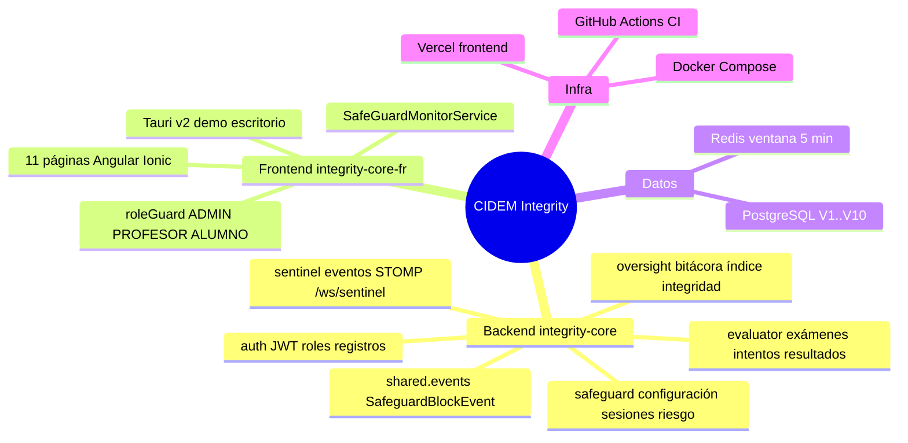

---

## 2. Contexto del sistema

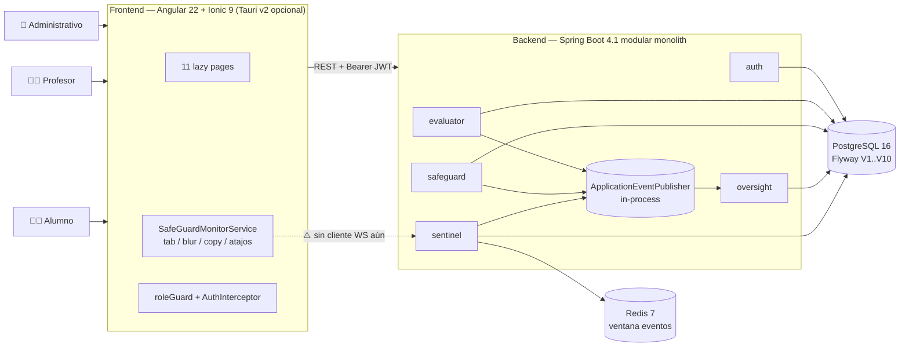

---

## 3. Módulos del backend y su superficie

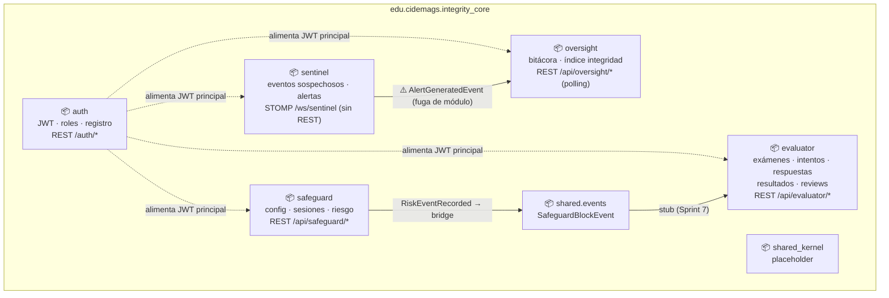

| Módulo | Persistencia | Superficie web | Estado |
|---|---|---|---|
| auth | Pg (V1,V2,V5) | REST `/auth/*` | ✅ completo |
| evaluator | Pg (V3,V4,V6,V10) | REST `/api/evaluator/*` | ✅ completo, sin eventos propios |
| safeguard | Pg (V7) | REST `/api/safeguard/*` | ✅ MVP (4 tipos sin regla de riesgo) |
| sentinel | Pg (V8) + Redis | STOMP `/ws/sentinel` | ✅ backend, sin cliente WS |
| oversight | Pg (V9) | REST `/api/oversight/*` | ✅ MVP, polling 30 s |
| shared_kernel | — | — | placeholder |

---

## 4. Grafo de eventos internos (lo que existe hoy)

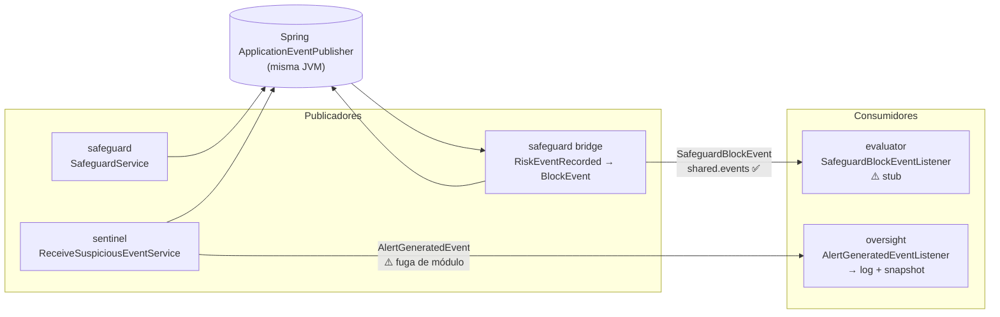

⚠️ Deuda conocida: listeners dentro de la transacción del publicador (falta
`AFTER_COMMIT`), evaluator no publica eventos, contratos incompletos en `shared.events`.

---

## 5. Flujos principales

### 5.1 Autenticación

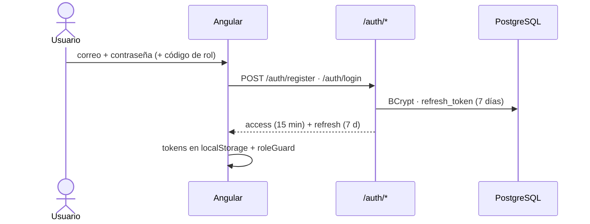

Roles → rutas: `ADMINISTRATIVO` (usuarios, códigos), `PROFESOR` (exámenes, oversight), `ALUMNO` (join por código).

### 5.2 Ciclo de examen (profesor → alumno → resultados)

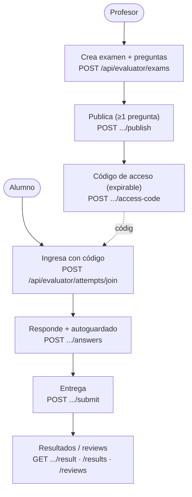

### 5.3 SafeGuard en el intento

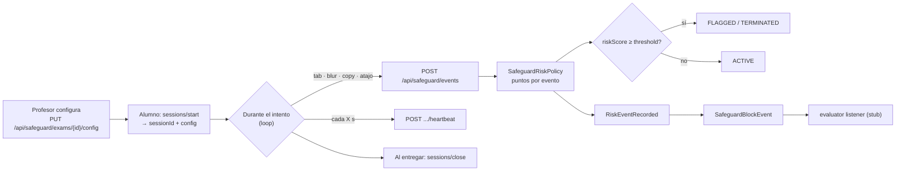

Violaciones detectadas en el frontend por `SafeGuardMonitorService`:
`visibilitychange`, `blur`, `copy/paste/cut`, menú contextual, atajos (F12, Ctrl+Shift+I…).

### 5.4 Sentinel (STOMP) y Oversight (polling)

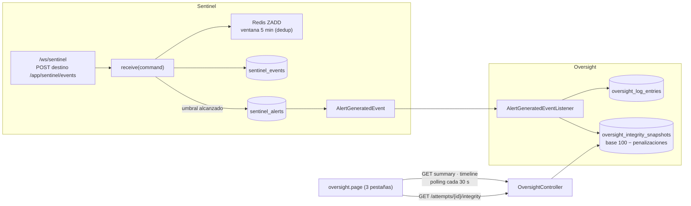

Índice de integridad: `GREEN ≥ 80` · `YELLOW 50–79` · `RED < 50`.

Nota: ⚠️ **solo Sentinel alimenta oversight hoy**; SafeGuard y evaluator no (Sprint 7 pendiente).
No existe `/ws/oversight` ni cliente WebSocket en el frontend — todo es REST + polling.

---

## 6. Modelo de datos (Flyway V1..V10)

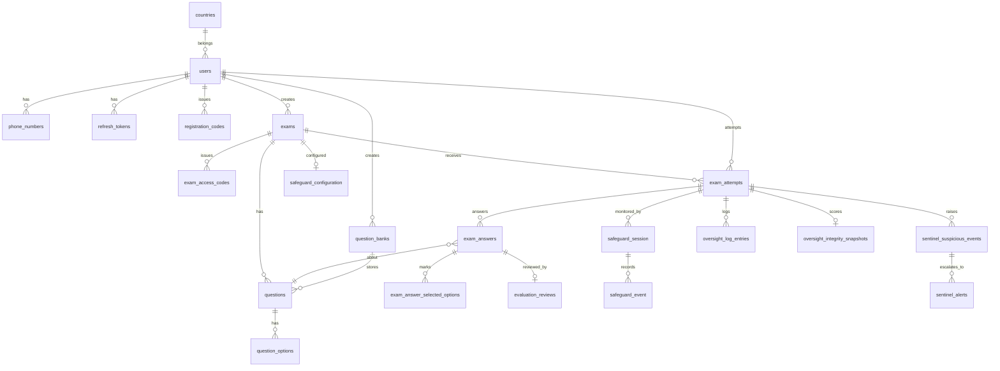

Migraciones: `V1` auth · `V2` códigos registro · `V3` evaluator · `V4` owner de bancos ·
`V5` seed México · `V6` timestamps review · `V7` safeguard · `V8` sentinel ·
`V9` oversight · `V10` puntos de pregunta + defaults safeguard. Nunca editar una `V*` aplicada.

---

## 7. Arquitectura hexagonal por módulo

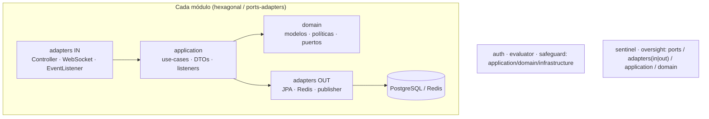

Gotchas del código: MapStruct está en el `pom.xml` pero **no se usa** (mappers
manuales); `ddl-auto: validate` — el esquema viene solo de Flyway.

---

## 8. Stack y pipelines

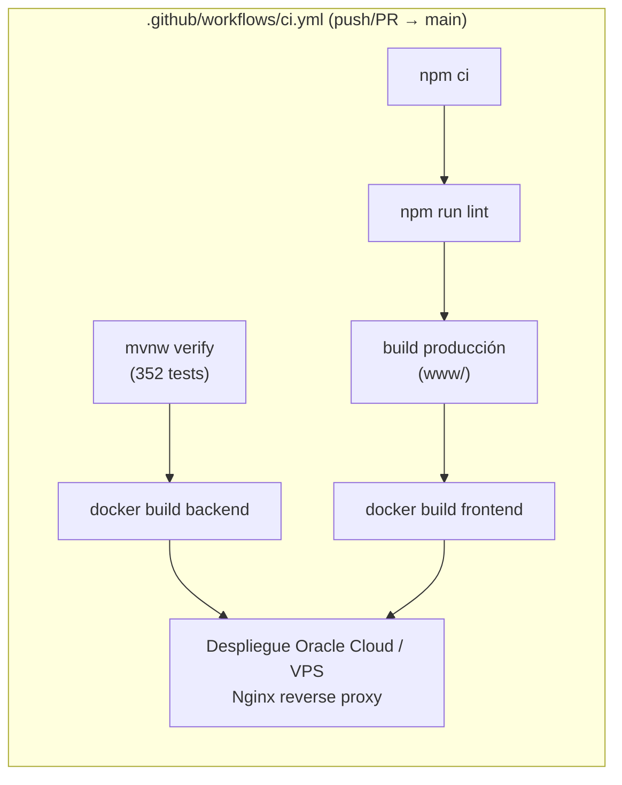

| Capa | Tecnología |
|---|---|
| Backend | Spring Boot 4.1 · Java 25 · Maven wrapper |
| BD | PostgreSQL 16 (Flyway, `ddl-auto: validate`) |
| Cache | Redis 7 (ventana deslizante de eventos) |
| Auth | JWT (access 15 min, refresh 7 d, rotación, rate-limit) |
| Realtime | STOMP WS (`/ws/sentinel`, interceptor JWT) — sin cliente FE |
| Frontend | Angular 22 zoneless · Ionic 9 · Bootstrap 5 · Vitest · Tauri v2 |
| Testing | JUnit 5 + Testcontainers (Pg+Redis) · Vitest |

---

## 9. Riesgos y pendientes (mapa de calor)

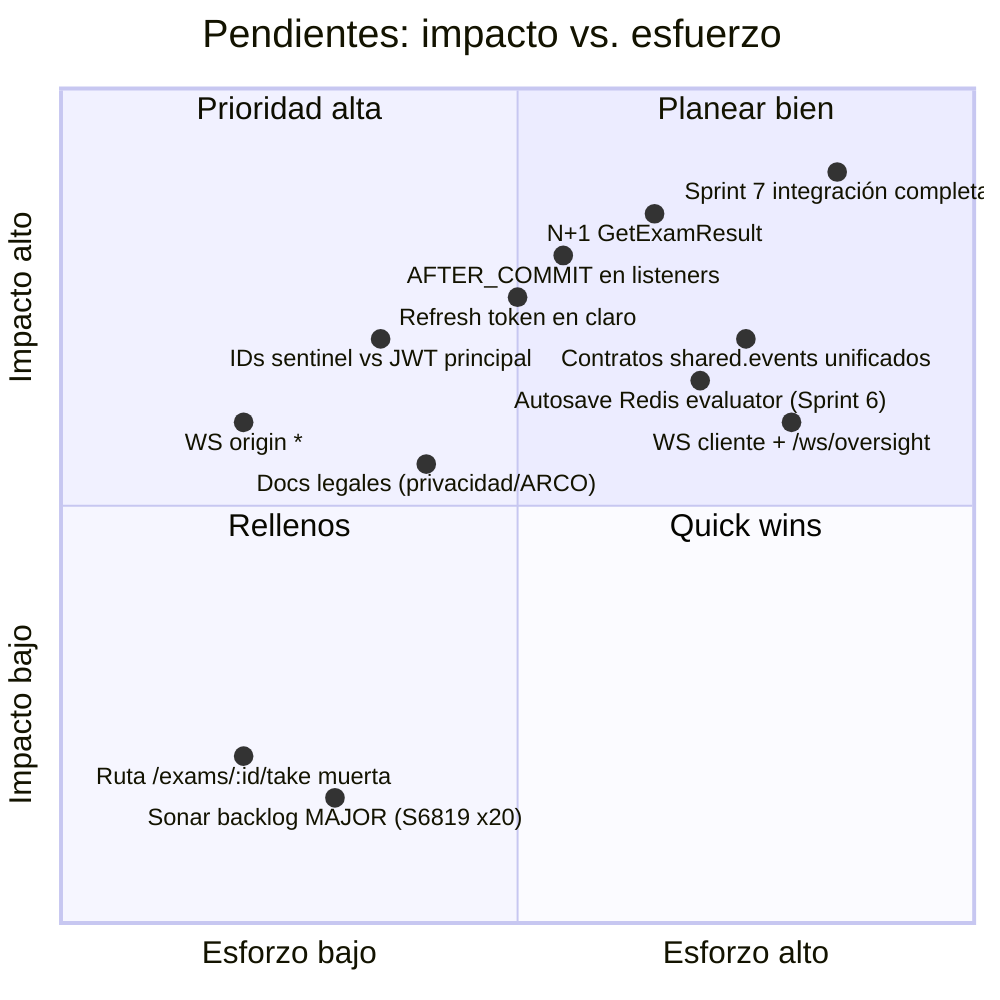

Top limitaciones MVP: sin bloqueo OS real · sin apps móviles · sin WS en
frontend · sin autosave Redis · refresh tokens en claro en localStorage ·
`metadata` JSON válido o 500 · 4 tipos de evento sin regla de riesgo.

---

## 10. Dónde está todo

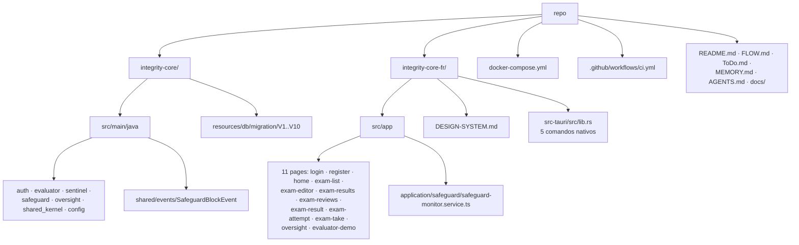
