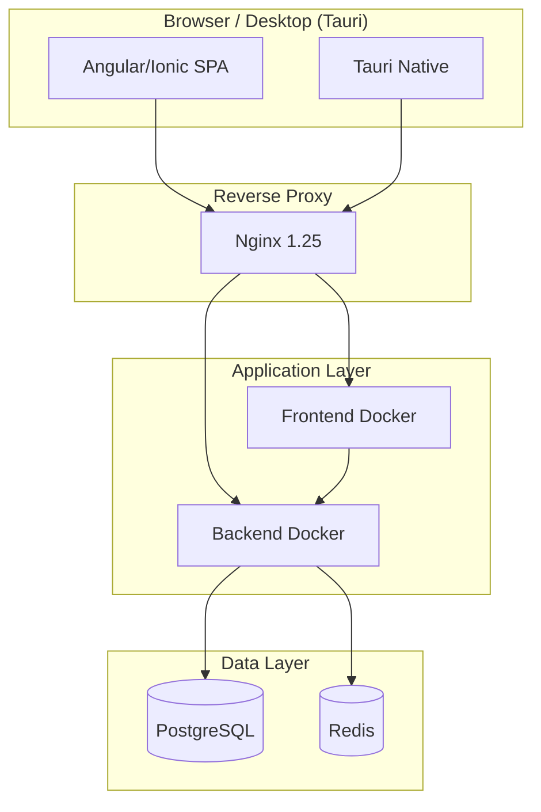

# Arquitectura CIDEM Integrity

## Visión general

CIDEM Integrity es una plataforma de integridad académica construida con una arquitectura modular:

- **Backend**: Spring Boot 4.1 / Java 25 — API REST + JWT + Flyway
- **Frontend**: Angular/Ionic 22 + Tauri (Rust nativo)
- **Infraestructura**: PostgreSQL (persistencia), Redis (cache/autosave)

## Módulos internos

| Módulo | Responsabilidad |
|--------|----------------|
| `oversight` | Panel de oversight del profesor; registra logs de eventos de seguridad |
| `sentinel` | Monitorización en tiempo real; alertas y notificaciones |
| `safeguard` | Detección de eventos (blur, shortcuts, copy/paste); reglas de restricción |
| `evaluator` | Cálculo de integridad; ponderación de eventos |
| `exam` | Gestión de exámenes, sesiones y estado del examen |

## Flujo de eventos

1. El **Alumno** interactúa con el examen (pérdida de foco, cambio de pestaña, copy/paste).
2. El **Safeguard** detecta el evento y publica `SafeguardBlockEvent` (Spring ApplicationEvent).
3. El **Oversight** suscriptor añade un `LogEntry` y recalcula el índice de integridad.
4. El **Evaluator** registra el evento en el estado del examen.
5. Si la restricción excede el umbral, el **Sentinel** publica una `SentinelAlertEvent` (toast al alumno, badge rojo).

## Tecnologías

- **Backend**: Spring Boot 4.1, Java 25, Maven, SpringDoc (OpenAPI), Testcontainers
- **Frontend**: Angular/Ionic 22, Node 24, Vitest + jsdom
- **Tauri**: Rust (Cargo), WebKitGTK (Linux), Webkit (Windows/macOS)
- **Datos**: PostgreSQL 16 (Docker), Redis 7 (Docker)
- **Infraestructura**: Nginx, Certbot/Let's Encrypt, GitHub Actions (CI/CD), Docker Compose
