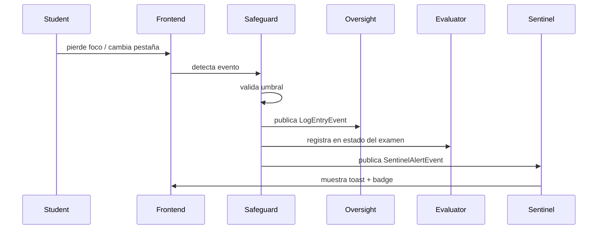

# Internal Events

## Tabla de eventos

| Evento | Tipo | Payload | Publica en | Consume en |
|--------|------|---------|------------|------------|
| `SafeguardBlockEvent` | `DOMAIN_EVENT` | `{type, maxOccurrences, windowSeconds}` | SAFEGUARD | OVERSIGHT, EVALUATOR |
| `SentinelAlertEvent` | `DOMAIN_EVENT` | `{alertType, severity, reason}` | SENTINEL | OVERSIGHT |
| `ExamStartedEvent` | `DOMAIN_EVENT` | `{examId, attemptId, studentId}` | EXAM | EVALUATOR, OVERSIGHT |
| `ExamCompletedEvent` | `DOMAIN_EVENT` | `{examId, attemptId, studentId, score}` | EXAM | EVALUATOR |
| `LogEntryEvent` | `DOMAIN_EVENT` | `{eventType, timestamp, details}` | OVERSIGHT | SENTINEL |

## Descripciones

- **`SafeguardBlockEvent`**: Se dispara cuando un evento de seguridad supera el umbral de restricciones. Los suscriptores reaccionan añadiendo un log o registrando el evento en el examen.
- **`SentinelAlertEvent`**: Se dispara cuando el monitor de integridad detecta una anomalía. El Oversight lo procesa para actualizar la UI en tiempo real.
- **`ExamStartedEvent`**: Marca el inicio de un intento de examen. El Evaluator lo usa para resetear el índice de integridad.
- **`ExamCompletedEvent`**: Marca el cierre del examen. El Evaluator calcula la calificación final basada en el índice de integridad.
- **`LogEntryEvent`**: Registro de evento de seguridad. El Sentinel lo consume para generar alertas en la UI.

## Diagrama de flujo

