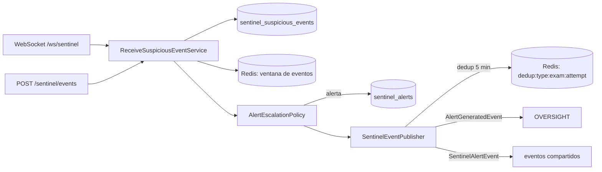

# Módulo Sentinel

Monitorea eventos sospechosos durante un intento de examen, los persiste y
escala a alertas según reglas de umbral.

## Propiedad de tablas

| Tabla | Rol |
|---|---|
| `sentinel_suspicious_events` | Exclusiva de Sentinel |
| `sentinel_alerts` | Exclusiva de Sentinel |

Sentinel **lee** (nunca escribe) `exams`, `exam_attempts` y `users` a través de
`SentinelDirectoryPort`, y valida la propiedad del intento con
`AttemptOwnershipPort`, implementado en `safeguard/infrastructure`.

## API (`/sentinel`)

| Método | Ruta | Roles | Regla de propiedad |
|---|---|---|---|
| POST | `/events` | ALUMNO, PROFESOR, ADMINISTRATIVO | Alumno: intento propio (el `studentId` sale del JWT) |
| GET | `/exams/{examId}/alerts` | PROFESOR, ADMINISTRATIVO | Profesor: examen propio |
| GET | `/attempts/{attemptId}/events` | ALUMNO, PROFESOR, ADMINISTRATIVO | Alumno: intento propio; profesor: examen propio |
| GET | `/sessions/{sessionId}/alerts` | PROFESOR, ADMINISTRATIVO | Profesor: examen de la sesión |
| PUT | `/alerts/{alertId}/resolve` | PROFESOR, ADMINISTRATIVO | Profesor: examen de la alerta |

La lógica de permisos vive en `application/service/AuthorizationService` y se
combina con `@PreAuthorize` en el controlador.

## Flujo de eventos



## Deduplicación (spec 07)

- Clave: `dedup:{alertType}:{examId}:{attemptId}`.
- TTL: 5 minutos.
- Si la clave existe, la alerta se registra como duplicada y no se publica.
- La responsabilidad es del publicador, no de los listeners.

## Contadores y reglas (spec 08)

- Contadores: `RedisCounterService` (`sentinel:counter:{EVENT_TYPE}`) con `INCR`
  y TTL aplicado en el primer incremento.
- Ventanas configurables en `application.yml`:

```yaml
sentinel:
  escalation:
    tab-switch-window: 300s
    focus-loss-window: 60s
    disconnection-window: 300s
    copy-paste-window: 120s
```

| Regla | Evento | Umbral | Severidad |
|---|---|---|---|
| TAB_SWITCH | TAB_OR_APP_SWITCH | 3 | LOW |
| FOCUS_LOSS | WINDOW_FOCUS_LOST | 5 | MEDIUM |
| DISCONNECTION | DISCONNECTION | 2 | HIGH |
| COPY_PASTE | COPY_PASTE | 4 | MEDIUM |

## Frontend

La pantalla `sentinel-alerts` (`/sentinel/alerts`) lista las alertas por examen
con filtros de severidad y fechas, paginación de 20 y acción de resolver.
